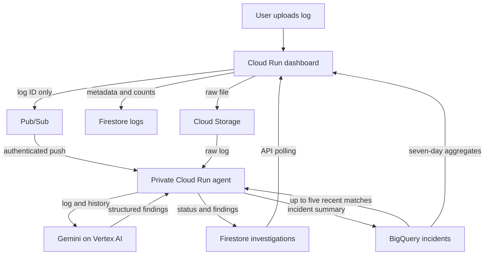
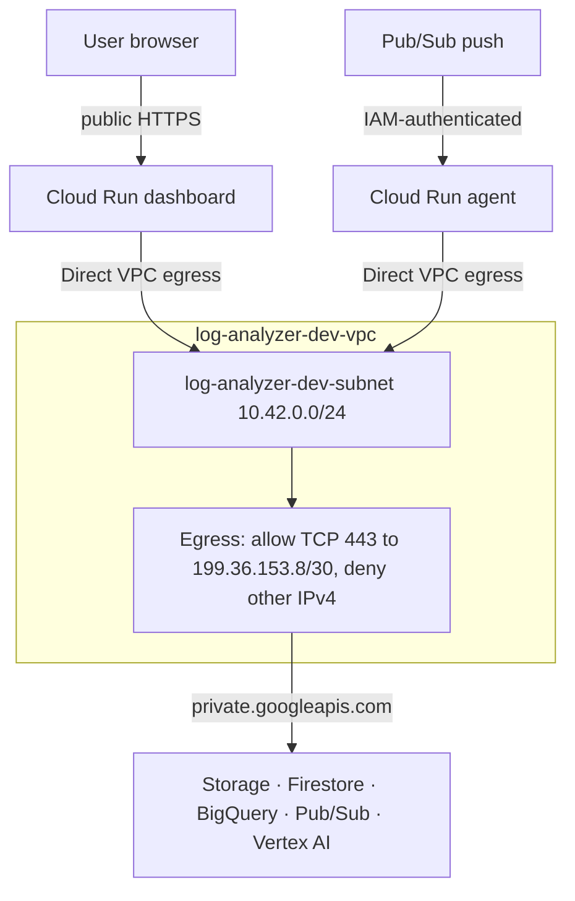

# GCP AI Log Analyzer

Upload a synthetic log, replay the incident it records, and review a Gemini investigation of it.

- **Dashboard** (public Cloud Run service `log-analyzer-dev`): uploads, ERROR/WARN counts, incident replay, seven-day reports.
- **Agent** (private Cloud Run service `log-analyzer-dev-agent`): receives a log ID from Pub/Sub, makes one Gemini call through ADK, and saves structured findings.

Findings are tentative suggestions. Use synthetic logs without credentials.

## Incident replay

Upload UTF-8 `.txt`, `.log` or `.jsonl` files (up to 1 MiB), or try one of three built-in scenarios (retry storm, token expiry, payment recovery). Previewing a scenario saves nothing and calls no model.

The replay parser (`replay.py`) reads structured text, JSON Lines and Cloud Logging JSON. It builds a timeline and a service map from recorded fields only. A shared trace ID alone does not create a connection, and the first failure shown is not necessarily the root cause. It scans up to 12,000 lines, samples to 1,200 events and maps at most 20 services. Replay makes no model calls.

## Data flow



The dashboard stores the file and metadata before it publishes `{"log_id": "UUID"}`. Raw text never enters the queue. The agent sends Gemini the first 24,000 characters, with numbered lines. The model has no tools; application code does every read and write. A Firestore lease and a deterministic BigQuery job ID make repeated Pub/Sub deliveries safe.

## Network



Private DNS zone `log-analyzer-dev-googleapis` resolves Google API names to `private.googleapis.com`. No NAT or VPC connector is used. IAM controls data access; this is not a VPC Service Controls perimeter. Provisioned by `infra/Configure-Network.ps1`.

## Layout

```
app.py, storage.py, analytics.py, investigations.py, replay.py   dashboard (WSGI)
static/                     dashboard UI and demo logs
tests/                      dashboard tests
requirements.txt, Dockerfile
agent_service/              agent: service.py, tests/, Dockerfile, bigquery-schema.json,
                            Deploy-Agent.ps1 (one-time bootstrap), Smoke-Test*.ps1 (live checks)
evals/                      golden-log eval: fixtures/, golden_logs.py, test_golden_logs.py, adk/
infra/                      Configure-Network.ps1, Analytics-VPC-handoff.md, terraform/ (notes, not applied)
cloudbuild.yaml, cloudbuild-ci.yaml   pipelines
```

## Run locally

```powershell
python -m venv .venv
.\.venv\Scripts\Activate.ps1
pip install -r requirements.txt
python -c "from wsgiref.simple_server import make_server; from app import application; make_server('127.0.0.1', 8080, application).serve_forever()"
```

Locally the dashboard uses SQLite (`data/logs.db`) and shows AI as disabled. Cloud Run sets `STORAGE_BACKEND=gcp` and the resource variables in `cloudbuild.yaml`.

## Tests

| Component | Command | Notes |
| --- | --- | --- |
| Dashboard | `python -m unittest discover -s tests -v` | root `requirements.txt` |
| Agent | `cd agent_service && python -m unittest discover -s tests -v` | separate venv with `agent_service/requirements.txt` |
| Eval scorer | `python -m unittest discover -s evals -v` | no dependencies, no cloud access |

Security checks, as CI runs them: `bandit -q app.py storage.py analytics.py investigations.py replay.py` and, from `agent_service`, `bandit -q service.py`.

## Golden-log eval

Four synthetic logs in `evals/fixtures/` each have an `.expected.json` with a minimum (and optional maximum) severity and keywords the summary or likely cause must mention. These calls reach Vertex AI and cost money. They need the agent dependencies and `GOOGLE_GENAI_USE_VERTEXAI`, `GOOGLE_CLOUD_PROJECT` and `GOOGLE_CLOUD_LOCATION`.

```
python evals/golden_logs.py --threshold 0.8
adk eval evals/adk/log_investigator evals/adk/golden_logs.evalset.json --config_file_path evals/adk/eval_config.json
```

`golden_logs.py` exits non-zero below the threshold, and a crash counts as a failure. The ADK eval uses rubric-based scoring with a judge model. Regenerate its eval set from the fixtures with `python evals/golden_logs.py --write-adk-evalset`. Neither eval runs in CI yet.

## Endpoints

Dashboard: `GET /health`, `POST /logs`, `GET /logs`, `GET /logs/{id}`, `GET /logs/{id}/replay`, `GET|POST /logs/{id}/investigation`, `GET|POST /investigations/{id}`, `GET /analytics`, `GET /replay/demo/{name}`.

Agent (IAM required):
- `GET /health`: liveness, no cloud calls.
- `GET /ready`: reads one Firestore document, the raw-log bucket's metadata and the incidents table's metadata, concurrently, 2 seconds each. Returns 200 `ready` or 503 `not_ready`, with only `ok` or `failed` per check.
- `POST /pubsub`: Pub/Sub push receiver.

## Deployment

| File | Trigger | Does |
| --- | --- | --- |
| `cloudbuild-ci.yaml` | PR into `dev` or `main` | tests, Bandit, pip-audit, image build and Trivy scan for both services |
| `cloudbuild.yaml` | push to `dev` | same checks, then publish both images and deploy the agent, then the dashboard |

Work on a `zein/...` branch, PR into `dev` (merging deploys), then promote to protected `main`. No production pipeline exists. Mahmoud owns both pipeline files. Runtime identities authenticate through ADC; there are no key files.

## Infrastructure

Project `ai-log-analyzer-511017`, region `us-central1`.

| Resource | Name |
| --- | --- |
| Cloud Run | `log-analyzer-dev`, `log-analyzer-dev-agent` |
| Artifact Registry | `log-analyzer-dev` |
| Raw-log bucket | `ai-log-analyzer-511017-raw-logs-dev` |
| Firestore | `(default)`: `logs`, `investigations` |
| Pub/Sub topic | `log-analyzer-dev-investigations` |
| BigQuery | `ai-log-analyzer-511017.log_analyzer_dev.incidents`, partitions expire after 7 days |

Terraform state: bucket `ai-log-analyzer-511017-tfstate`, prefix `dev`. Nothing is applied yet; planned changes are in [infra/terraform](infra/terraform/README.md). Details: [agent](agent_service/README.md), [analytics and VPC](infra/Analytics-VPC-handoff.md).

## Known gaps

- The dashboard is public and unauthenticated. `GET /logs` lists recent uploads and `GET /logs/{id}` returns any upload's content.
- No upload rate limit or budget alert. Instance limits cap parallelism, not spend.
- Identical uploads each trigger a Gemini call; content-hash reuse is planned.
- Service and category detection (`classify_log`) is keyword-based with three categories. Unmatched logs are `unclassified` and get less history.
- Agent ingress is `all`; internal-only is documented but not applied.
- No VPC Service Controls perimeter.
- Firestore documents and raw logs have no retention cleanup.
- A crash after the model responds but before findings are saved repeats a paid call.
- The golden-log evals have not been run against Vertex AI and are not in CI.
