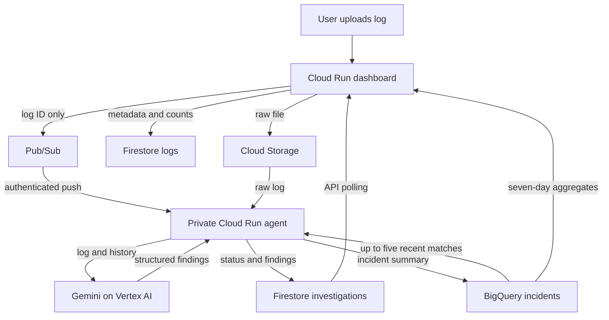
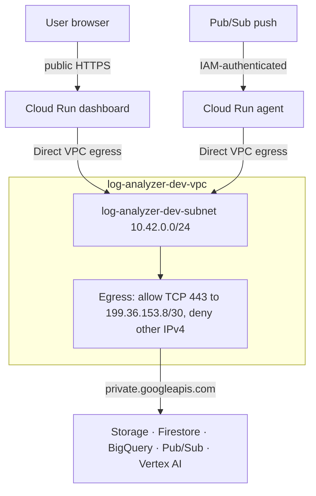

# Architecture

## Data flow

The dashboard stores the file and metadata before it publishes `{"log_id": "UUID"}`. Raw text never enters the queue. The agent sends Gemini the first 24,000 characters, with numbered lines. The model has no tools; application code does every read and write. A Firestore lease and a deterministic BigQuery job ID make repeated Pub/Sub deliveries safe.

## Network

Private DNS zone `log-analyzer-dev-googleapis` resolves Google API names to `private.googleapis.com`. No NAT or VPC connector is used. IAM controls data access; this is not a VPC Service Controls perimeter. Provisioned by `infra/scripts/configure-network.ps1`.

Details: [analytics and VPC handoff](analytics-vpc-handoff.md), [planned ingress change](../infra/terraform/README.md).
